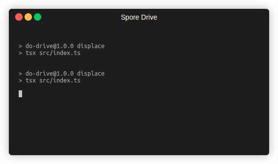

# @taubyte/spore-drive

Gone are the days of relying on third parties to build and maintain cloud infrastructure for your software. **spore-drive** empowers you to deploy, scale, and manage your [Tau](https://github.com/taubyte/tau) cloud infrastructure with code!



## Installation

### npm
```sh
npm install @taubyte/spore-drive
```

### yarn
```sh
yarn add @taubyte/spore-drive
```

## Usage

A cloud is described by its config directory (`cloud.yaml`, `hosts.yaml`,
`shapes.yaml`, `auth.yaml`, optional `added.yaml`, and the key files they
name). The client reads it into a `Document`, the service validates and
deploys it.

```ts
import { Document, Drive, TauLatest } from "@taubyte/spore-drive";

const drive = await Drive.local(); // runs the local spore-drive service
// or: new RemoteDrive("http://localhost:PORT/")

// Validate generates any missing secret (swarm key, domain validation keys,
// host node keys). Write the normalized document back, or the next run
// generates different ones.
const { errors, document } = await drive.validate(await Document.fromDir("./config"));
if (errors.length) throw new Error(errors.join("\n"));
await document.toDir("./config");

const course = await drive.plan(document, { tau: TauLatest, shapes: ["all"] });

for await (const p of drive.apply(course)) {
  console.log(p.hop, p.host, p.step, p.progress, p.error);
}
```

A document can also be built in memory:
`Document.fromObject({ "cloud.yaml": "...", "hosts.yaml": "..." })`.

`drive.abort(course)` cancels a planned or running course; leaving the
`apply` loop early does too. An unapplied course expires after 15 minutes.

Tau sources: `TauLatest`, `TauVersion("v1.2.3")`, `TauUrl(url)`, `TauPath(path)`.
